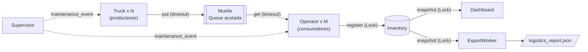

# Centro Logístico Concurrente (`logistics_center`)

## 1. Descripción

Simulador de un centro logístico implementado con hilos de Python. Camiones
descargan lotes de paquetes en un muelle de capacidad limitada, operarios los
toman y los registran en un inventario central, un dashboard muestra métricas
en vivo, un exportador persiste periódicamente un reporte JSON y un supervisor
("chaos monkey") provoca pausas de mantenimiento aleatorias.

Combina dos problemas clásicos de concurrencia:

- **Productor-consumidor:** los camiones (`Truck`, productores) y los operarios
  (`Operator`, consumidores) se comunican a través del muelle, una
  `queue.Queue` acotada.
- **Lectores-escritores:** los operarios escriben en el `Inventory`, mientras
  que el `Dashboard` y el `ExportWorker` lo leen. Todos acceden con un único
  `Lock`; los lectores reciben un *snapshot* inmutable, de modo que el lock se
  mantiene solo durante la copia y el formateo o la escritura en disco ocurren
  fuera de la sección crítica.

## 2. Arquitectura

| Clase | Rol | Primitivas de sincronización |
|---|---|---|
| `BaseWorker` (`workers/base.py`) | Base abstracta de todos los hilos (patrón *Template Method*): bucle, condición de corte y manejo de errores | `stop_event` y `maintenance_event` (`threading.Event`) |
| `Truck` (`workers/truck.py`) | Productor: genera lotes de 3 a 8 paquetes y los encola | `Queue.put` con timeout, `stop_event`, `maintenance_event` |
| `Operator` (`workers/operator.py`) | Consumidor/escritor: toma paquetes y los registra | `Queue.get` con timeout, `task_done`, `producers_finished`, `maintenance_event` |
| `Dashboard` (`ui/dashboard.py`) | Lector: muestra métricas en la terminal | `Inventory.snapshot()` (Lock), `Queue.qsize`, `stop_event` |
| `ExportWorker` (`workers/exporter.py`) | Lector: exporta un reporte JSON periódico | `Inventory.snapshot()` (Lock), `stop_event` |
| `Supervisor` (`workers/supervisor.py`) | Activa y desactiva pausas de mantenimiento al azar | `maintenance_event`, `stop_event` |
| `Inventory` (`core/inventory.py`) | Recurso compartido: stock por SKU y estadísticas | `threading.Lock` |

Flujo de datos:



## 3. Mecanismos de concurrencia

| Mecanismo | Implementación | Archivo |
|---|---|---|
| Exclusión mutua | Toda lectura y escritura del inventario pasa por un único `Lock`; los lectores reciben un `InventorySnapshot` inmutable (`MappingProxyType`) | `core/inventory.py` |
| Sin espera activa | Los hilos se bloquean en `Queue.put/get` y en `Event.wait`, nunca en bucles que consumen CPU. Durante una pausa de mantenimiento se consulta el flag cada 0,1 s mediante `stop_event.wait` | `workers/base.py` |
| Timeouts | Toda operación bloqueante tiene timeout (`QUEUE_TIMEOUT_SECONDS`, `JOIN_TIMEOUT_SECONDS`, `DRAIN_TIMEOUT_SECONDS`), así que la señal de parada se revisa periódicamente | `config.py`, `workers/` |
| Apagado ordenado en dos fases | Fase 1: `stop_event` detiene camiones, dashboard, exportador y supervisor. Fase 2: se activa `producers_finished` y los operarios vacían el muelle antes de terminar, sin perder paquetes. Al final se hace una última exportación y se imprime un resumen | `main.py` (`shutdown`, `run_workers`), `workers/operator.py` |
| Robustez del apagado | `producers_finished` se activa aunque un segundo Ctrl+C interrumpa la fase 1, y el apagado también corre si falla el `start()` de algún hilo | `main.py` |
| Falla rápida | Una excepción no controlada en un hilo se guarda, se registra y activa `stop_event` para detener toda la simulación | `workers/base.py` |
| Pausas de mantenimiento (*chaos*) | El supervisor alterna períodos normales (2–5 s) y pausas (0,5–2 s). Durante la pausa, camiones y operarios esperan antes de tomar trabajo nuevo; un paquete ya tomado siempre se registra. Al detenerse, el supervisor siempre limpia el flag | `workers/supervisor.py`, `workers/base.py` |
| Exportación JSON atómica | Se escribe en un archivo temporal del mismo directorio, se hace `fsync` y luego `os.replace`, con reintentos y backoff exponencial si Windows bloquea el destino. Un error de E/S solo saltea ese ciclo | `workers/exporter.py` |

## 4. Requisitos e instalación

- Python 3.10 o superior (se usa la sintaxis `X | None`; probado con 3.14).
- Sin dependencias externas: solo la biblioteca estándar.

Entorno virtual opcional, creado desde `APO/`:

```bash
python -m venv .venv
# Windows
.venv\Scripts\activate
# Linux / macOS
source .venv/bin/activate
```

## 5. Uso

Ejecutar desde `APO/logistics_center`:

```bash
cd logistics_center
python main.py
```

### Opciones (`python main.py -h`)

| Flag | Descripción | Default |
|---|---|---|
| `--trucks N` | Cantidad de hilos camión (productores), >= 1 | 2 |
| `--operators N` | Cantidad de hilos operario (consumidores), >= 1 | 3 |
| `--queue-size N` | Capacidad del muelle en paquetes, >= 1 | 50 |
| `--processing-seconds SECONDS` | Tiempo simulado que tarda un operario por paquete, > 0 | 0.2 |
| `--export-path PATH` | Destino del reporte JSON | `logistics_report.json` |
| `--export-interval SECONDS` | Segundos entre exportaciones periódicas, > 0 | 5.0 |
| `--no-chaos` | Desactiva el supervisor (sin pausas de mantenimiento) | — |
| `--log-level LEVEL` | Umbral de logging: DEBUG, INFO, WARNING, ERROR o CRITICAL | WARNING |
| `--log-file PATH` | Escribe los logs en ese archivo en lugar de stderr | — |

Los valores inválidos (por ejemplo `--trucks 0` o `--processing-seconds -1`)
terminan con un error de uso. Conviene mantener el nivel de log en WARNING o
superior, o usar `--log-file`, para que los logs no rompan el dashboard.

Ejemplo:

```bash
python main.py --trucks 4 --operators 2 --queue-size 20 \
    --processing-seconds 0.5 --export-interval 2 --no-chaos \
    --log-level INFO --log-file simulation.log
```

### Dashboard

Se redibuja en la terminal cada 0,5 s y muestra: paquetes recibidos, unidades
recibidas, tamaño actual de la cola del muelle y stock por SKU.

### Detener la simulación

Presionar **Ctrl+C**. Se ejecuta el apagado en dos fases: los operarios vacían
el muelle, se realiza una exportación final y se imprime en stdout un resumen
con paquetes registrados, unidades, paquetes que quedaron en el muelle y stock
final por SKU.

### `logistics_report.json`

Se crea en el directorio actual (o en `--export-path`) y contiene:

```json
{
  "timestamp": "2026-10-13T22:02:34.236868-03:00",
  "packages_received": 14,
  "units_received": 81,
  "stock": {"SKU-A": 16, "SKU-B": 14, "SKU-C": 28, "SKU-D": 23},
  "dock_size": 0
}
```

`timestamp` está en ISO 8601 con zona horaria, `stock` está ordenado por SKU y
`dock_size` indica los paquetes que esperan en el muelle.

## 6. Tests

Desde `APO/logistics_center`:

```bash
python -m unittest discover -s tests -t . -v
```

| Archivo | Qué valida |
|---|---|
| `test_base_worker.py` | Una excepción no controlada se guarda y dispara el apagado; `stop_event` termina el hilo |
| `test_inventory.py` | Totales consistentes con escritores concurrentes, snapshot inmutable, rechazo de unidades no positivas |
| `test_operator_drain.py` | Los operarios registran los paquetes pendientes tras el apagado y siguen activos hasta que terminan los productores |
| `test_maintenance_pause.py` | Camiones y operarios se detienen durante una pausa y se reanudan; el apagado tiene prioridad sobre una pausa trabada |
| `test_supervisor.py` | El supervisor alterna pausas, limpia el flag al detenerse y no registra las pausas como WARNING |
| `test_chaos.py` | Prueba de estrés: con pausas aleatorias no se pierden ni se duplican paquetes; el apagado durante una pausa vacía el muelle; control negativo que verifica que la prueba detecta pérdidas |
| `test_dashboard.py` | El frame muestra métricas y tamaño del muelle; el dashboard se detiene con `stop_event` |
| `test_export.py` | Contenido del reporte, un lector concurrente nunca ve JSON parcial, parada rápida a mitad de intervalo, destino bloqueado saltea el ciclo |
| `test_shutdown.py` | Un Ctrl+C durante la fase 1 igual libera y vacía a los operarios; una falla en `start()` detiene los hilos ya iniciados |
| `test_cli.py` | Defaults iguales a `config.py`, overrides aplicados, valores inválidos terminan con `SystemExit`, `--no-chaos` omite el supervisor |
| `test_report.py` | El resumen final se imprime en stdout sin importar el nivel de log y también queda registrado en el log |

## 7. Estructura de carpetas

```text
APO/
├── README.md
└── logistics_center/
    ├── main.py              # Punto de entrada: CLI, armado de hilos, apagado y resumen
    ├── config.py            # Constantes de la simulación
    ├── core/
    │   ├── inventory.py     # Inventory e InventorySnapshot (Lock)
    │   └── package.py       # Package (dataclass inmutable)
    ├── ui/
    │   └── dashboard.py     # Dashboard de terminal
    ├── workers/
    │   ├── base.py          # BaseWorker
    │   ├── truck.py         # Productor
    │   ├── operator.py      # Consumidor
    │   ├── exporter.py      # Exportación JSON atómica
    │   └── supervisor.py    # Chaos monkey
    └── tests/               # Tests con unittest
```
